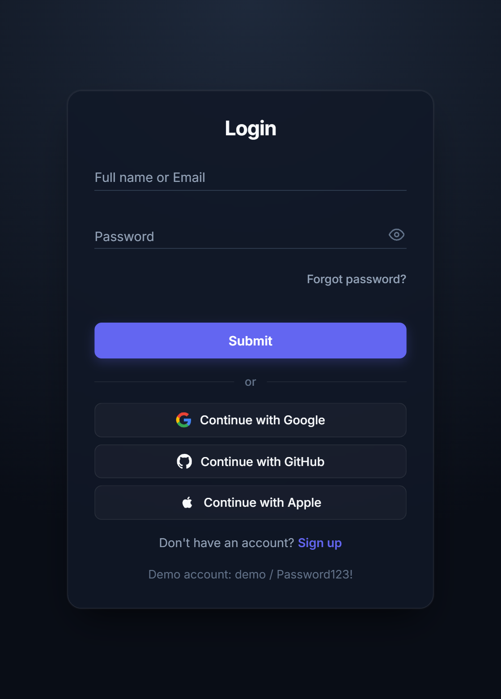
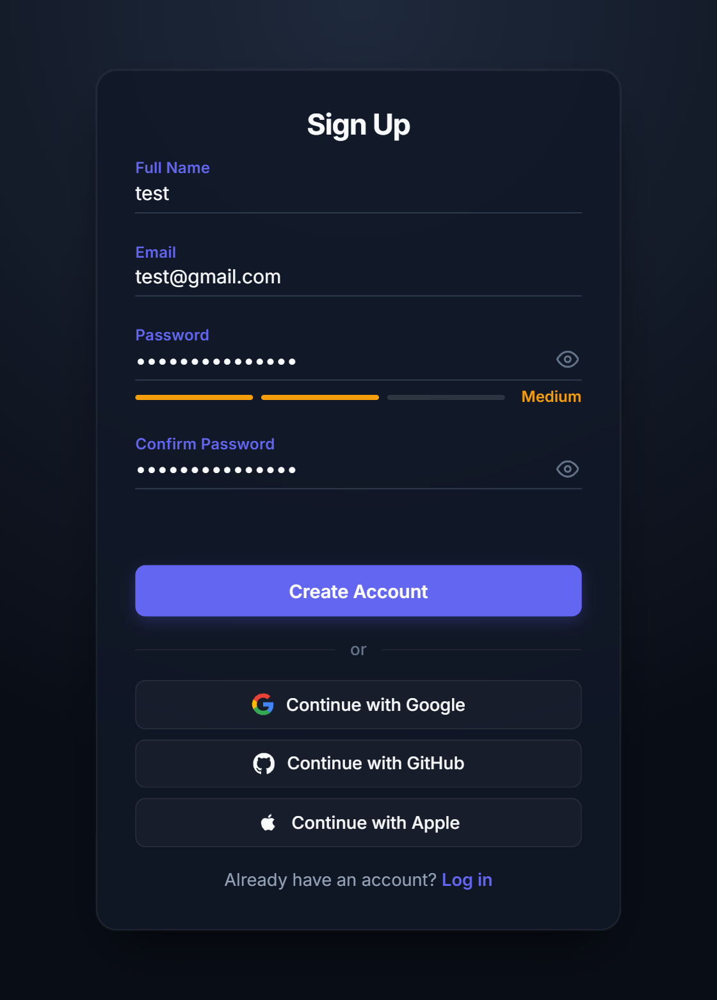
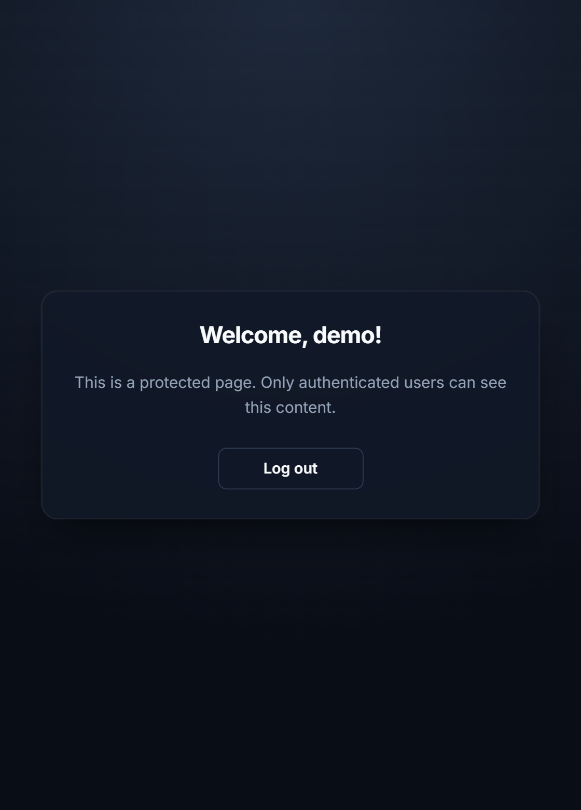

# Auth Forms

A responsive, accessible authentication flow built with plain HTML, CSS and JavaScript: login, sign up, forgot password and a protected dashboard.

**Live demo:** https://smah-ir.github.io/auth-forms/

<p>
  
  
  
</p>

## Demo account

Use these credentials on the login page, or create your own account on the sign up page.

```
Full name or email: demo
Password: Password123!
```

## Features

- Login with full name or email, sign up with duplicate-account detection
- Live validation on blur and input, with focus moved to the first invalid field
- Password strength meter (Weak / Medium / Strong) and show/hide password toggle
- Confirm-password check that re-validates when the password changes
- Forgot password form with email validation
- Protected dashboard that redirects logged-out visitors to login, and logged-in visitors away from the auth pages
- Simulated "Continue with Google / GitHub / Apple" buttons
- Accessible: labels, `aria-invalid`, `aria-describedby`, `role="alert"`, `aria-live` messages, visible `:focus-visible` styles
- Responsive layout and `prefers-reduced-motion` support
- BEM class naming and CSS custom properties for the whole color system

## Tech stack

HTML5, CSS3 (custom properties, flexbox, BEM), vanilla JavaScript (ES6+), localStorage. No frameworks or build step.

## Project structure

```
auth-forms/
├── index.html
├── style/
│   └── style.css
├── login/
├── signup/
├── forgot-password/
└── dashboard/
```

Each page folder contains its own HTML and JS file. All pages share `style/style.css`.

## Run locally

```
git clone https://github.com/SMAH-ir/auth-forms.git
cd auth-forms
```

Open the folder in VS Code and use the **Live Server** extension (right-click `index.html`, then "Open with Live Server").

Avoid opening the files by double-clicking them. Firefox gives every `file://` page its own separate localStorage, so the login state is not shared between pages and the redirects loop.

## Important notes

This is a front-end demo, not real authentication.

- **No backend.** Accounts are stored in the browser's localStorage, and passwords are saved in plain text. A real app hashes passwords on the server and never stores them in the browser.
- **Simulated OAuth.** The Google, GitHub and Apple buttons don't connect to any provider. They just log you in as a demo user.
- **Browser-only route protection.** The dashboard guard checks a localStorage flag, so anyone can bypass it with DevTools. Real protection needs a server that verifies the session.
- **Forgot password sends nothing.** No email is sent. The form shows the same message for every valid address, so it never reveals whether an account exists, which is the behavior a real implementation should keep.

## Author

Jason ([@SMAH-ir](https://github.com/SMAH-ir))